<div align="center">


# FlowList

**Organize seu dia, uma tarefa por vez.**

Aplicativo desktop de lista de tarefas com calendário e perfil, feito com **Electron** e **Bootstrap**.

## 📌 Sobre o projeto

O **FlowList** é um aplicativo desktop para quem quer organizar tarefas, prazos e compromissos em um só lugar. O usuário cria uma conta, entra no app e, a partir daí, pode cadastrar tarefas com **prazo** e **prioridade**, acompanhar tudo em um **calendário** e ver o seu **desempenho** na tela de perfil.

O projeto foi desenvolvido como atividade acadêmica, com foco em:

- planejar as funcionalidades e o fluxo do usuário **antes** de programar;
- construir uma interface **simples e intuitiva** com Bootstrap;
- manter uma **arquitetura organizada**, com cada parte do app em seu lugar.

---

## ✨ Funcionalidades

| Tela | O que o usuário pode fazer |
| --- | --- |
| 📝 **Cadastro** | Criar conta com nome completo, e-mail e senha forte (mín. 8 caracteres, com letra maiúscula, número e símbolo). |
| 🔐 **Login** | Entrar com e-mail e senha. Sem sessão ativa, o app volta para o login. |
| 🏠 **Início** | Receber boas-vindas, criar a primeira tarefa e ver as tarefas **atrasadas** e **para hoje**. |
| ✅ **Minhas tarefas** | Criar, editar, concluir e excluir tarefas. Filtrar por **Todas**, **Pendentes**, **Atrasadas** e **Concluídas**. Escolher o dia com atalhos (*Hoje*, *Amanhã*, *+7 dias*, *Nenhum*). |
| 📅 **Calendário** | Navegar pelos meses, ver as tarefas de cada dia por cor de prioridade e criar uma atividade direto no dia escolhido. |
| 👤 **Perfil** | Editar o nome, alterar a senha e ver estatísticas: total, pendentes, concluídas, % de conclusão e pendentes por prioridade. |

**Outros detalhes:**

- 🎨 Menu lateral compartilhado entre as telas, com destaque na tela atual.
- 🚫 Dias que já passaram ficam bloqueados ao agendar uma tarefa.
- 👥 Cada usuário vê apenas as **suas** tarefas.
- 🔒 Senhas salvas com **PBKDF2-SHA-256** (salt aleatório e 310.000 iterações), nunca em texto puro.

---

## 🧭 Fluxo do usuário

```mermaid
flowchart LR
    A([Abrir o app]) --> B[Login]
    B -- "Não tem conta?" --> C[Cadastro]
    C -- "Conta criada" --> B
    B -- "Login válido" --> D[Início]
    D --> E[Minhas tarefas]
    D --> F[Calendário]
    D --> G[Perfil]
    E <--> F
    E & F & G -- "Sair" --> B
```



1. O app abre na tela de **Login**.
2. Quem ainda não tem conta clica em **Cadastre-se**, preenche os dados e volta para o login.
3. Com um login válido, o usuário chega à tela de **Início**.
4. Pelo menu lateral, ele navega entre **Tarefas**, **Calendário** e **Perfil**.
5. O botão **Sair** encerra a sessão e leva de volta ao login.

---

## 🏗️ Arquitetura

O Electron separa o app em duas partes que conversam de forma segura:

| Camada | Arquivo | Responsabilidade |
| --- | --- | --- |
| **Processo principal** | `main.js` | Cria a janela, controla o ciclo de vida do app, bloqueia navegação para páginas de fora e responde às chamadas IPC. |
| **Ponte segura** | `src/preload/preload.js` | Expõe só o necessário para as telas (`window.api`) usando `contextBridge`. |
| **Telas (renderer)** | `src/<tela>/` | Cada tela tem seu próprio HTML, CSS e JS. |
| **Componentes** | `src/componentes/` | Partes reaproveitadas: menu lateral, navegação, datas e mini calendário. |
| **Dados** | `src/storage.js` | Toda a leitura e gravação de usuários, sessão e tarefas fica concentrada aqui. |

### Fluxograma


### 🔐 Segurança

- `contextIsolation: true`, `nodeIntegration: false` e `sandbox: true` na janela.
- O app só abre as telas permitidas, sem janelas extras nem sites externos.
- Toda chamada IPC confere se veio de uma tela do próprio app.

### 💾 Armazenamento

Os dados de contas e tarefas ficam no `localStorage` do aplicativo, no próprio computador. Contas criadas na versão anterior do app têm a senha atualizada para o formato novo no próximo login.

> [!NOTE]
> Como os dados ficam salvos localmente, essa proteção serve para um app didático. Não é um sistema de autenticação para dados sensíveis: quem tiver acesso ao computador ainda pode ver ou alterar os dados.

---

## 📂 Estrutura de pastas

```text
desktop-tutorial/
├── main.js                  # Processo principal do Electron
├── package.json             # Dependências e script de execução
├── fluxograma.png           # Diagrama da arquitetura
└── src/
    ├── storage.js           # Usuários, sessão, tarefas e senhas
    ├── preload/
    │   └── preload.js       # Ponte segura entre o Electron e as telas
    ├── componentes/
    │   ├── menu.html/.css/.js   # Menu lateral compartilhado
    │   ├── navegacao.js         # Troca entre telas
    │   ├── datas.js             # Funções de data
    │   ├── minicalendario.js    # Seletor de dia das tarefas
    │   └── telas.css            # Estilos comuns
    ├── login/               # Tela de login
    ├── cadastro/            # Tela de cadastro
    ├── principal/           # Tela de início
    ├── tarefas/             # Lista de tarefas
    ├── calendario/          # Calendário de tarefas
    ├── perfil/              # Perfil e estatísticas
    └── imagens/
        └── icon.png         # Ícone do app
```

---

## 🚀 Como executar

### Pré-requisitos

- [Node.js](https://nodejs.org/) (versão LTS) e npm
- [Git](https://git-scm.com/)

### Passo a passo

```bash
# 1. Clone o repositório
git clone 

# 2. Entre na pasta
cd 

# 3. Instale as dependências
npm install

# 4. Abra o aplicativo
npm start
```

---

## 🛠️ Tecnologias

| Tecnologia | Uso no projeto |
| --- | --- |
| [Electron](https://www.electronjs.org/) | Transforma o app web em um programa desktop |
| [Bootstrap 5](https://getbootstrap.com/) | Layout, componentes e janelas (modais) |
| [Bootstrap Icons](https://icons.getbootstrap.com/) | Ícones da interface |
| [Inter (Fontsource)](https://fontsource.org/fonts/inter) | Fonte usada no app, instalada localmente |
| HTML, CSS e JavaScript | Estrutura, visual e lógica das telas |
| Web Crypto API | Proteção das senhas com PBKDF2 |

---

## 👥 Equipe

 Arthur Lima  
 Karollayne Correia
